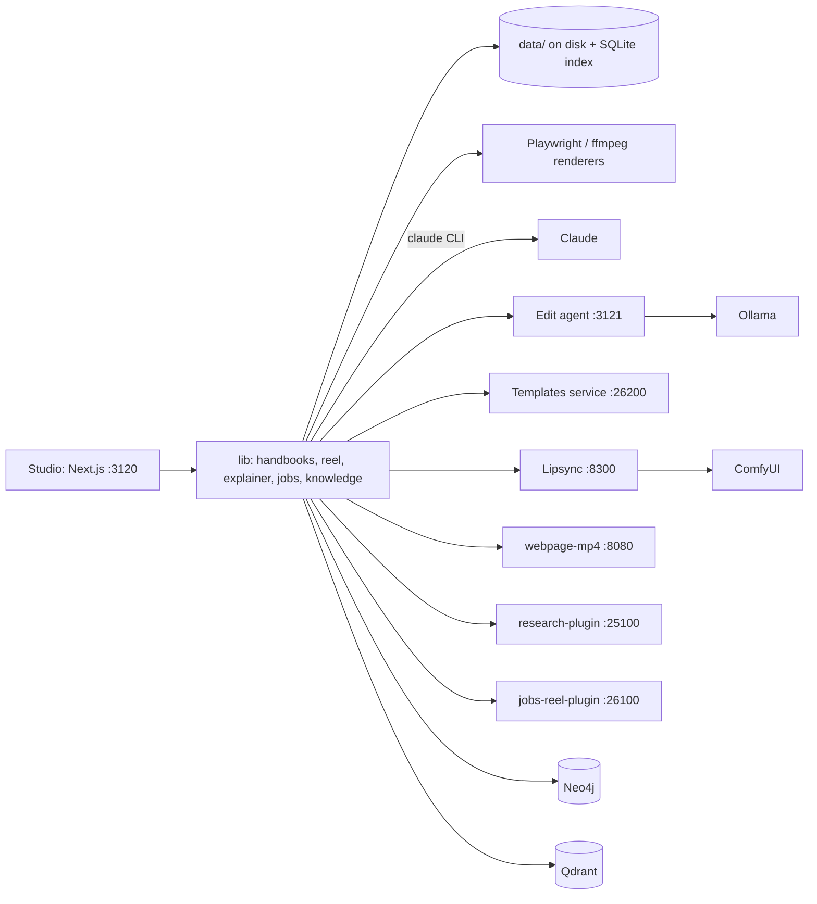

# 🎬 Iolar Studio

> A local studio for Instagram content: handwritten-notes carousels, reels, job cuts and concept explainers.

**Everything runs on one Windows machine. Claude and local models plan and write, deterministic renderers draw, and files on disk stay the source of truth.**

<!-- readme-header -->
       

## What it does

- **Handbooks.** Content is organised Subject, Chapter, Part. A topic or reference images become structured `post.json`, rendered by Playwright through a template (spiral-notes, blackboard, sketchnote, sticky-wall and others under `templates/`) into carousel PNGs plus a caption. Layout packs blocks into columns and spills overflow onto the next part; text is never shrunk to fit. AI edits go through diff-and-approve. Optional ComfyUI polish.
- **Reels.** `data/reel/<slug>/reel.json` is filled by re-runnable stages: plan, voice (Piper, with SAPI fallback), whisper word timings, shots (ComfyUI image-to-video or Ken Burns stills), assemble, export with ffmpeg. Word timings are the timing authority. A studio view edits the timeline, and the design shares one stylesheet, one motion module and one timeline resolver between the browser preview and the ffmpeg export. No pixel-parity test is committed.
- **Pattern reels.** A reel with a pattern (`tools`) is rendered by `main-reels-templates-plugin` on 26200 from one JSON document.
- **Explainers.** Scripted single-diagram concept animations, rendered through the same templates service (`lib/explainer/`, `/explainers`).
- **Jobs.** Pulls the job pool from `research-plugin`, prepares weekly or daily cuts, submits them to `jobs-reel-plugin` and keeps a ledger (`lib/jobs/`, `/jobs`).
- **Research and knowledge layer.** Claude-driven research with human gates, plus a Neo4j graph (one space per category) and Qdrant agent memory. Both stores are derived from `data/` and rebuildable.
- **Plugins page.** Health of every service the studio depends on, with start buttons for those that can be started from here.
- **Local edit agent.** A FastAPI and LangGraph service (`agent/`, port 3121) that proposes reel edits using Ollama.
- Stories, quote cards and memes are scaffolded routes only.

## Architecture



## Quickstart

Needs Node 20+, Windows paths in defaults, and the `claude` CLI on PATH for research, planning and AI revise. Everything else degrades: no ComfyUI leaves shots `awaiting-manual`, no whisper stops the reel after audio, no `claude` makes the revise chat return 503.

```bash
npm install
npx playwright install chromium
npm run dev          # http://localhost:3120
npm test             # vitest, includes real-Chromium render tests
```

`docs/STATE.md` records that on the author's machine `npm run dev` fails because an Application Control policy blocks the SWC binary, and `npx next dev --webpack -p 3120` is used instead.

Optional pieces: `npm run setup:whisper`, `npm run setup:voice` (Piper), `docker compose -f docker/compose.yml up -d` (Neo4j on 3124/3125, Qdrant on 3126/3127, volumes on `D:`), `docker compose -f agent/compose.yml up -d --build` (edit agent), `npm run reindex:knowledge` to rebuild the stores from `data/`. Tests, lint and build were not run while writing this README.

## Configuration

Service URLs are read from the environment: `COMFY_URL`, `OLLAMA_URL`, `LIPSYNC_URL`, `WEBPAGE_MP4_URL`, `RESEARCH_URL`, `JOBS_REEL_URL`, `REELS_TEMPLATES_URL`, `PLUGIN_ROOT`, `IOLAR_DATA_DIR`. Brand, defaults and the ComfyUI checkpoint live in `data/settings.json`. Voice and hero-shot providers default to local engines; Higgsfield is used only when a setting names it.

## Rendering notes

- A handbook template is `templates/<name>/` with `template.html` (markers `<!--HEAD-->`, `<!--CONTENT-->`, `<!--PAGEVARS-->`) and `manifest.json`.
- `tests/golden.test.ts` re-renders `tests/fixtures/golden-post.json` with every template and compares against `tests/golden/*.png` (skipped if that folder is absent). After intentional visual changes run `node scripts/approve-goldens.mjs`, inspect the PNGs, then commit.
- A creator style is `styles/<name>/` (`style.json`, `caption.css`, optional `hook.html`). `POST /api/reel/styles/clone` drafts one from a reference reel by measuring cuts and the caption band; treat the result as a draft.

## Project layout

```
app/        Next.js routes (handbooks, reels, explainers, jobs, graph, plugins, settings, api)
lib/        handbooks and renderer, reel engine, explainer, jobs, knowledge, plugins, verify
templates/  handbook page templates      scenes/  scene HTML for reels
agent/      reel edit agent (FastAPI + LangGraph)
docker/     Neo4j and Qdrant compose
scripts/    setup, reindex, migrate, golden approval
docs/       STATE.md, implementation.json, handbooks/, superpowers/ specs and plans
```

## Decisions

Specs and plans are in `docs/superpowers/specs/` and `docs/superpowers/plans/` (handbooks, reels engine, reel patterns, jobs bridge, knowledge graph, explainers, content verification). `docs/STATE.md` is the handoff log, last updated for the 31 August to 3 September work, so it predates the explainers category.

## Status

Private, single-user, work in progress. No CI workflow. Local `AGENTS.md` and `CLAUDE.md` carry the Next.js agent-rules block.
